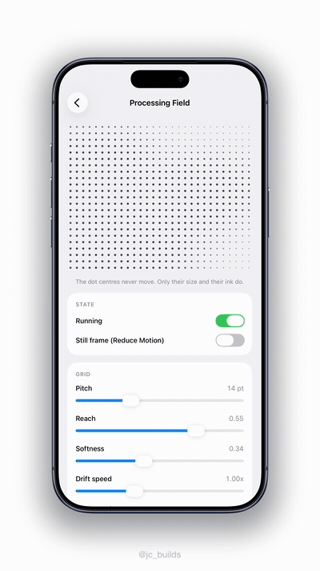

# ProcessingField

A SwiftUI progress field: a grid of marks whose sizes describe one soft shape that drifts, folds and breathes while your app is busy.

<p align="center">
  
</p>

<p align="center">
  <sub><a href="Docs/demo.mp4">The same clip as an mp4</a>, which holds the faint outer specks better than a GIF can &middot; what is being driven is <code>reach</code> and then <code>pitch</code></sub>
</p>

The mark centres never move. They sit on a fixed square grid, and only each mark's size and its ink change, which is what makes this read as one surface working rather than as particles flying about. What the sizes describe is a single mass: marks inside it stand at full size, marks outside fade to specks but are never absent, and the outline between them wobbles as the shape wanders.

It is one `Canvas` inside one `TimelineView`, with no view per mark. It draws no background and takes no hits, so it drops onto anything as an overlay in one line.

## Requirements

| | |
|---|---|
| Swift | 5.9 |
| Platforms | iOS 15, macOS 12, tvOS 15, watchOS 8, visionOS 1 |
| Dependencies | SwiftUI. Nothing else. |

## Installation

**Xcode.** File > Add Package Dependencies, then paste:

```
https://github.com/haplollc/ProcessingField
```

**Package.swift.**

```swift
dependencies: [
    .package(url: "https://github.com/haplollc/ProcessingField", from: "1.0.0")
],
targets: [
    .target(
        name: "YourTarget",
        dependencies: ["ProcessingField"]
    )
]
```

## Usage

The smallest thing that shows you something. It fills whatever it is offered and inks itself in `Color.primary`, so this is a working screen:

```swift
import SwiftUI
import ProcessingField

struct ContentView: View {
    var body: some View {
        ProcessingField()
    }
}
```

### Over a poster

What it was built for: covering an image or a video still while the real work happens behind it. The field fills what it is given and draws no background of its own, so on a rounded card it needs an overlay and a clip. `processingFieldOverlay(_:in:)` is the short spelling of both:

```swift
Image("poster")
    .resizable()
    .scaledToFill()
    .frame(height: 260)
    .processingFieldOverlay(
        ProcessingField(isActive: isImporting, ink: .white),
        in: RoundedRectangle(cornerRadius: 24, style: .continuous)
    )
```

Only the field is clipped, and it still takes no hits, so a button underneath stays a button. The shape defaults to `Rectangle()`, which is what a square cornered card wants.

Over a photograph the marks usually want something to sit on. Add your own scrim; the field will not draw one for you:

```swift
poster
    .overlay(Color.black.opacity(isImporting ? 0.45 : 0))
    .processingFieldOverlay(ProcessingField(isActive: isImporting, ink: .white))
```

Note that `isActive: false` parks the field on a still frame rather than hiding it. To take it away entirely, leave the overlay off:

```swift
poster.overlay {
    if isImporting {
        ProcessingField(ink: .white)
    }
}
```

### Lines

The same shape and the same maths, drawn with short segments tangent to the outline, so they comb around the mass:

```swift
ProcessingField(style: .lines, ink: .white)
```

`ProcessingFieldStyle` is `CaseIterable` and `Identifiable`, and each case carries a plain English `label`, so a demo or a debug screen can offer both without a wrapper. The labels are deliberately not localized: ship your own wording if the choice is ever put to real users.

```swift
Picker("Style", selection: $style) {
    ForEach(ProcessingFieldStyle.allCases) { style in
        Text(style.label).tag(style)
    }
}
```

### Parked, and Reduce Motion

Pass `isActive: false` when the work is done. The timeline leaves the view tree and the field rests on a still frame:

```swift
ProcessingField(isActive: false)
```

Reduce Motion needs no code from you. When the system asks for it, the field builds no `TimelineView` at all and draws the same still frame.

## Parameters

Every parameter has a default, so reach for one only when you want it.

| Parameter | Default | What it does |
|---|---|---|
| `style` | `.dots` | `.dots` for filled circles, `.lines` for segments that comb around the shape. Texture only: neither says anything the other does not. |
| `isActive` | `true` | `false` parks the field on a still frame and drops the timeline. Set it from whatever the work is. |
| `pitch` | `14` | Points between mark centres, nudged to divide the width evenly. Smaller is a fine mist, larger is a coarse bold grid. The most visible knob there is. |
| `ink` | `.primary` | The one colour in the field. Monochrome by design: nothing here can be read as a percentage. Use `.white` over a dark scrim. |
| `reach` | `0.40` | How far the mass spans, as a fraction of each axis. Lower it to make the shape a subject inside a surround of specks; raise it to fill the frame. |
| `softness` | `0.34` | The shoulder either side of the outline. Larger is mistier, smaller is a harder edge. |
| `minRadiusRatio` | `0.085` | Mark radius outside the shape, as a fraction of the pitch. This floor is what keeps every mark present. Take it to `0` only if you want marks to vanish. |
| `maxRadiusRatio` | `0.19` | Mark radius inside the shape, as a fraction of the pitch. Raise it for a heavier field. |
| `minInk` | `0.30` | Opacity outside the shape. Lower it when the field sits on a busy photo and the surround is too loud. |
| `maxInk` | `0.85` | Opacity inside the shape. |
| `driftSpeed` | `1` | How fast the mass wanders the frame. `0` pins it in place and lets it fold without travelling. |
| `foldSpeed` | `1` | How fast the outline folds and the mass breathes. `0` freezes the form and lets it only travel. |
| `lineLengthScale` | `2.4` | `.lines` only. Half the segment length, as a multiple of the radius the same mark would have as a dot. Past about `2.9` the segments overlap, which is a flow field look rather than a field of marks. |
| `lineWeightScale` | `0.9` | `.lines` only. Segment thickness, as a multiple of that same radius. |

## How it works

The grid is fixed. Columns and rows are worked out once from the size on offer and the pitch, nudged so a whole number of cells fills the width and nothing is half drawn at an edge. Nothing on that grid ever moves.

Each frame asks every mark one question: how far inside the shape am I? The shape is a circle in the mark's coordinates, bent by three slow folds whose speeds and depths share no common measure, so it never folds the same way twice. The answer turns over across a soft shoulder either side of the outline, so marks swell into the shape instead of popping on, and it decides only two things: the mark's radius and its ink. `.lines` asks one more question, for the angle: which way is out of the shape from here? The segment is drawn square to that, which is why the marks comb around the mass.

Every mark in the grid is drawn every frame. Outside the shape they are small and quiet, never absent, so the lattice is always there and the shape is read in the swelling of it.

**What it costs.** One `Canvas` in one `TimelineView(.animation(minimumInterval: 1 / 30))`, so 30 frames a second at most, and one fill or stroke per mark. At the default 14 point pitch that is about 450 marks a frame in a 390 by 220 band, about 640 in a 320 point hero, and about 1,700 over a full iPhone screen. A smaller `pitch` is the expensive knob: halving it roughly quadruples the mark count. Under Reduce Motion there is no `TimelineView` in the tree at all, so the cost is one frame and then nothing.

## Examples

`Examples/` holds two files that are not part of the library and that the package does not compile. Copy either into a scratch app.

`ProcessingFieldExamples.swift` is three small real uses: a card being filled in, the field as the whole picture, and both marks side by side.

`ProcessingFieldPlayground.swift` is the screen in the clip at the top of this page. It puts every knob on a slider so you can feel what each one does before picking numbers for your own app.

## Credit

Built at Haplo LLC. Released under the [MIT licence](LICENSE).
